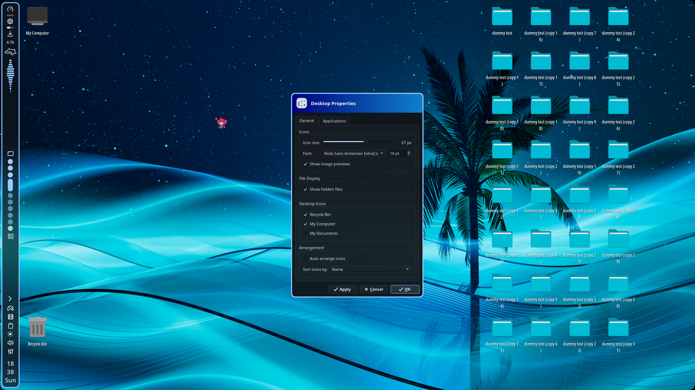

# SakuraDesktopIcons

> A modified and updated fork of [Oh My Desktop](https://github.com/EduuG/oh-my-desktop), renamed and adapted as [**SakuraDesktopIcons**](https://github.com/cherryCTL/SakuraDesktopIcons).

> This version was updated for my personal Hyprland setup, mainly to fix compatibility issues with newer Hyprland versions and update parts of the original project that no longer worked correctly.
>
> I didn't originally know C++, so I used AI assistance to help me understand, debug, and update the code. Feel free to read through the code and review the changes before using it on your own system.

<a href="screenshot.png"></a>

> **So, you might be wondering: what's so silly about this?**
>
> Honestly, nothing.
>
> **That's what makes it silly. :D**

Desktop icons manager for Hyprland. Hyprland has no built-in desktop icon support, so this fills that gap.

Built with C++17 and Qt6 + LayerShellQt, it provides a proper desktop with drag-and-drop, keyboard navigation, multi-monitor support, and file watching.

<p>
<a href="https://github.com/cherryCTL/SakuraDesktopIcons"></a>
<a href="https://github.com/cherryCTL/SakuraDesktopIcons"></a>
<a href="https://github.com/cherryCTL/SakuraDesktopIcons"></a>
<a href="https://github.com/cherryCTL/SakuraDesktopIcons"></a>
<a href="https://github.com/cherryCTL/SakuraDesktopIcons"></a>
</p>

## Tech Stack

* **Language:** C++17
* **Framework:** Qt6 (QGraphicsScene-based icon management)
* **Wayland:** LayerShellQt for layer-surface windows
* **Compositor integration:** Hyprland IPC via socket2
* **Build:** CMake 3.20+

## Build

```bash
cd SakuraDesktopIcons
rm -rf build
mkdir build
cd build

cmake .. -DCMAKE_BUILD_TYPE=Release
cmake --build . -j$(nproc)
```

Requires Qt6 and LayerShellQt development packages.

The included `install.sh` uses these verified package names for the supported
distributions:

* EndeavourOS/Arch: `base-devel cmake git pkgconf qt6-base qt6-wayland
  layer-shell-qt`
* Fedora: `gcc-c++ cmake git pkgconf-pkg-config qt6-qtbase-devel
  qt6-qtwayland-devel wayland-devel layer-shell-qt-devel`
* Debian/Ubuntu: `build-essential cmake git pkg-config extra-cmake-modules
  qt6-base-dev qt6-wayland-dev qt6-declarative-dev libwayland-dev
  libxkbcommon-dev wayland-protocols`, plus the LayerShellQt development
  package exposed by the distribution repositories.

The installer can build and install the application interactively:

```bash
./install.sh
```

Choose the build/install action from its menu. It installs the executable to
`~/.local/bin/SakuraDesktopIcons`. Run `./install.sh` again and choose the
uninstall action to remove that executable; user configuration is intentionally
left in place.

## Runtime Dependencies

* `hyprctl`
* `gio`
* `xdg-mime`
* `xdg-open`
* A system terminal

Sound playback is optional. The application uses `canberra-gtk-play` for
system sound-theme events when available. Explicit custom files can use
PipeWire `pw-play` or PulseAudio `paplay`. If none is installed, sound events
are skipped and the rest of the application continues normally. Preview
failures should be diagnosed by running the selected backend manually.

## Run

### Hyprland Lua

For Hyprland configurations using `hyprland.lua`:

```lua
hl.on("hyprland.start", function()
    hl.exec_cmd("/full/path/to/SakuraDesktopIcons/build/SakuraDesktopIcons")
end)
```

Or, if the binary is available in your `PATH`:

```lua
hl.on("hyprland.start", function()
    hl.exec_cmd("SakuraDesktopIcons")
end)
```

`hl.exec_cmd()` starts the process asynchronously, so no `&` or `disown` is required.

### Lua Startup

For unknown reasons, `SakuraDesktopIcons` did not start correctly from Lua's startup event on my system when using the normal command. I was able to fix it by adding a 2-second delay. I suspect the startup order after Noctalia's shell may be causing this issue.

If you experience the same problem, use this command in your Lua startup:

```lua
hl.exec_cmd("sleep 2 && SakuraDesktopIcons")
```


## Features

### Core

* Grid layout with manual positioning and Ctrl+multi-select
* Drag icons to move them — they snap to the nearest free cell
* Ctrl+scroll to resize icons (24–96px range)
* Image previews for common formats
* `.desktop` files use `Name=` and `Icon=` from the entry
* Create executable `.desktop` launchers from New → Desktop Entry
* Desktop Entry creation supports Application, Link, and Directory types,
  working directory, categories, destination, filename, and overwrite checks
* Installed entries can be edited from Settings → Desktop Entry
* Configure the application through the Settings dialog
* Optional System Tray with About, Settings, and Restart actions

### Themes and Appearance

* Built-in selectable themes: Sakura, Noctalia, Normal Dark, Joyfull Sea, and Emerald Green.
* The optional custom theme is selected from Settings → Appearance with
  “Choose Custom Theme File...” and “Use custom theme instead”. Its JSON path
  and enabled state are persisted independently of the selected built-in theme.
* Noctalia colors are read safely from the generated `noctlia.lua` format.
* Custom theme files use hexadecimal JSON colors; see `custom-theme-doc.txt`
  and `examples/custom-theme.json`.
* Settings-window dimensions, icon appearance, and animation preferences are persisted.

Qt and LayerShellQt do not provide a portable Wayland backdrop-blur API for
these ordinary application surfaces. The Emerald Green theme uses layered
opaque surfaces as a reliable fallback and does not require expensive blur.

### Sounds

The Sounds settings use the Linux desktop sound-theme mechanism through
`canberra-gtk-play` when it is available. PipeWire `pw-play` and PulseAudio
`paplay` are used for explicitly supplied custom files by the sound module.
Missing audio backends or unavailable event sounds are ignored without
preventing the desktop from starting.
The Sounds tab also supports per-event custom files, preview, and restoring
the system sound-theme default.
* Positions and settings saved to `~/.config/SakuraDesktopIcons/icon-positions.ini`
* Existing settings are copied automatically from
  `~/.config/HyprSillyDesktopIcons/icon-positions.ini` on first launch after
  upgrading; the legacy file is retained as a rollback backup.

### File Management

* Drag files onto the Recycle Bin or onto folders
* Smart text file opening
* File watcher automatically refreshes when the Desktop folder changes
* Recycle Bin accepts file drops and has an "Empty Recycle Bin" action
* Monitor-specific icon layouts with legacy shared-position fallback
* Panel reservations are refreshed from Hyprland while running

### Keyboard

* Arrow keys to navigate
* Enter to open
* Delete to trash
* Type-to-select files by name
* Full keyboard navigation without a mouse

### Animations

New, pasted, and externally dropped icons fade in and briefly bounce with a
short stagger. Right-clicking scales an icon briefly, dragging produces a
subtle wobble, and deletion confirmation produces a short shake before any
file operation occurs. Selected icons receive an attention pulse. These visual
effects are painted without changing widget geometry or saved positions. The
master, individual effect, speed, and intensity controls are in Appearance →
Animations. `GTK_ENABLE_ANIMATIONS=0` or `SAKURA_REDUCED_MOTION=1` disables
animations by default when no explicit saved preference exists.

### Context Menus

* Right-click the desktop for:

  * New Folder / Document / Desktop Entry
  * Open in Terminal
  * Arrange
  * System actions
  * Settings
* Right-click icons for:

  * Open
  * Rename
  * Delete
  * Properties
* Optional virtual icons:

  * Recycle Bin
  * My Computer
  * My Documents

### Wayland Integration

* Workspace switches clear menus and selection through Hyprland socket2
* Each monitor gets its own LayerShellQt window at `LayerBackground`
* Automatically accounts for panel areas when positioning the desktop

## How It Works

### LayerShellQt Windows

One desktop window is created for each monitor and rendered as a background layer surface. This keeps the desktop visible while placing it behind normal application windows.

When a new monitor is connected, a new desktop window is created automatically.

### Inline Menus

Standard `QMenu` popups can be unreliable when used from Wayland layer-shell surfaces.

SakuraDesktopIcons uses custom inline menus instead. These are regular child widgets positioned around the cursor, avoiding the popup grab issues that can occur with native menus on Wayland.

### Hyprland IPC

The application communicates with Hyprland at runtime rather than depending on Hyprland headers or compile-time integration.

It uses:

* `hyprctl` for monitor information
* Hyprland's socket2 IPC for workspace and focus events

If Hyprland IPC is unavailable, the desktop icon functionality can still operate, although workspace-aware behavior will be unavailable.

### Grid Layout

The desktop grid handles:

* Manual icon positioning
* Drag-and-drop
* Cell occupation
* Multi-selection
* Icon resizing
* Automatic snapping to available cells

## Notes

This project is mainly maintained for my personal Hyprland setup and experimentation.

If you like this project, consider giving the original author a ⭐ on [Oh My Desktop](https://github.com/EduuG/oh-my-desktop). It's genuinely a really good project, and this project wouldn't exist without it.


---

## Added Features & Bug Fixes in v1.1

### Added Features

* **Configurable window launching:** Added a setting to choose whether launched applications should open as floating windows or use the normal tiling layout.
* **Custom floating window dimensions:** Added configurable width and height settings for floating application windows.
* **Improved application launch handling:** Updated application and file-opening logic to better respect the configured window behavior.
* **File manager support:** Added direct file manager launching with support for several common Linux file managers.
* **Virtual desktop icons:** Improved handling of the Trash, Root, and Home desktop icons.
* **Installer improvements:** Added an interactive installer that can detect available binaries, report their versions, build from source, install the application, and uninstall it.

### Fixed Issues

* Improved launch behavior for applications opened through desktop icons.
* Fixed several application and file-opening paths that did not correctly use the configured launch settings.
* Improved handling of virtual desktop icons and file manager launch requests.

## Known Issues

The following issues are still present in v1.1 and are planned to be addressed in a future release.

* **File manager window behavior:** When a file manager such as Thunar is already open, double-clicking desktop icons associated with the file manager may open the resulting window maximized or tiled, regardless of the configured floating window setting.
* **Virtual icon window dimensions:** The Trash, Root, and Home icons may open their windows as floating windows with a fixed size of 720 × 720 pixels, instead of respecting the configured floating window dimensions and launch behavior.

## Next Release Planning

The following improvements are planned for the next release:

* **Fix file manager window handling:** Ensure that opening files and directories while a file manager is already running respects the configured floating or tiling behavior.
* **Fix virtual icon launch settings:** Make the Trash, Root, and Home icons consistently respect the configured window behavior and floating dimensions.
* **Add a top screen boundary for desktop icons:** Prevent icons from being dragged underneath panels positioned at the top of the screen, similar to the existing handling of reserved screen areas.


## Custom themes

Select **Custom** in Settings → Appearance and choose a JSON file. The example is `examples/custom-theme.json`. Required field: `name`. Optional fields are `windowBackground`, `windowText`, `accent`, `highlight`, `highlightedText`, `menuBackground`, `menuText`, and `border`; omitted or invalid colors use safe fallbacks. The selected path is persisted and reread whenever the theme is applied.

## Noctalia colors

The Noctalia theme reads the generated Lua declarations from `/home/cherry/.config/hypr/noctlia.lua` (and compatible user-home fallbacks). It safely parses only `localName = "rgb(hexvalue)"` declarations and never executes Lua.
